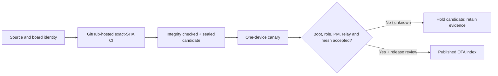

# Documentation

**The guide to building, installing and verifying BSEED Zigbee firmware.**

[Project overview](../README.md) · [Firmware availability](bseed_socket_release_status.md) · [Latest candidate notes](releases/2026-11-02-link-policy-candidates.md) · [Release history](changelog_fw.md)

> [!IMPORTANT]
> **Published**, **sealed**, **installed** and **hardware-accepted** are different states. A successful build, OTA transfer, or Zigbee2MQTT update announcement does not prove that a device has booted or passed its hardware tests. [Read the status definitions](bseed_socket_release_status.md#what-the-states-mean).

## Find the right starting point

| Your task | Start here | Then read |
| --- | --- | --- |
| Identify a socket or dimmer | [Exact BSEED device identities](bseed_unified_v8.md) | [Firmware availability](bseed_socket_release_status.md) |
| AVATTO modules or other BSEED TS0726 switches | [Analienx AVATTO and TS0726 release](analienx_release.md) | [Router reliability](router_reliability.md) |
| Install an offered public image | [Installation and OTA precautions](updating.md) | [Known issues](known_issues.md) |
| Evaluate the newest firmware | [Candidate release notes](releases/2026-11-02-link-policy-candidates.md) | [Acceptance and rollout gates](bseed_socket_release_status.md#promotion-gates-in-order) |
| Run an authorized single-device canary | [Targeted OTA operator guide](bseed_targeted_ota_runner.md) | [PM hardware acceptance](bseed_pm_e2e_acceptance.md) |
| Investigate parent loss or route instability | [Parent and route link policy](bseed_link_policy.md) | [Client recovery review](bseed_client_parent_recovery_20261013.md) |
| Contribute a fix or publish firmware | [Contributing](../CONTRIBUTING.md) | [Safe release process](contribute/release.md) |

## Firmware lifecycle

An image must pass the gates on **its own exact hardware and role**. No later stage is inferred from an earlier one.

| Evidence layer | What it proves | What it **does not** prove |
| --- | --- | --- |
| Source + CI | Tests, compile integrity and reproducibility at an exact commit | Connectivity or safe behavior on physical hardware |
| Sealed firmware | The native OTA bytes and identity are fixed and traceable | That every device can boot this image |
| Zigbee2MQTT OTA result | The transport reported its outcome | Installed Basic build, restored bindings or usable metering |
| Postflash canary | Device-specific identity, role and selected live functions | The full physical acceptance and extended soak |
| Release acceptance | Reviewed hardware evidence for the exact board and role | Safe cross-flashing to visually similar devices |

## Browse by subject

### Install and operate

- [Standing BSEED OTA risk acknowledgement](bseed_ota_operator_authorization.md) — one operator-level acknowledgement for the whole device fleet, no repeat consent prompts; technical checks remain per-device

- [Updating over Zigbee2MQTT](updating.md) — exact model check, index and recovery limits
- [Targeted OTA runner](bseed_targeted_ota_runner.md) — a bounded, one-device campaign
- [Published vs candidate firmware](bseed_socket_release_status.md) — the authoritative human-readable status page
- [Known issues](known_issues.md) and [support](../SUPPORT.md)

### Engineering and hardware

- [BSEED unified V8 architecture](bseed_unified_v8.md) — what is shared, what remains target-specific
- [Analienx AVATTO and BSEED TS0726 release](analienx_release.md) — one Router identity for every AVATTO and TS0726 Router board, built, started and self-activated per board
- [Parent/route link policy](bseed_link_policy.md) — hysteresis, recovery priorities and diagnostics
- [PM Router/Client verification](bseed_pm_variant_matrix.md) — exact-source role matrix
- [PM end-to-end acceptance](bseed_pm_e2e_acceptance.md) — physical load and telemetry gates
- [Firmware changelog](changelog_fw.md) — newer changes first, historical material retained

### Releasing and contributing

- [Release notes index](releases/README.md) and [release-note template](releases/TEMPLATE.md)
- [Release procedure](contribute/release.md) — candidate → canary → publication
- [Contributor guide](../CONTRIBUTING.md), [device database](supported_devices.md) and [security](../SECURITY.md)

## Upstream and scope

This repository maintains hardware-specific additions on top of [Romasku's original Tuya Zigbee Switch](https://github.com/romasku/tuya-zigbee-switch). The broader device database contains upstream-supported hardware; it **does not** imply that BSEED Router/Client images can be flashed interchangeably. The six public BSEED index entries are verified separately from any experimental Client or transition artifacts.
